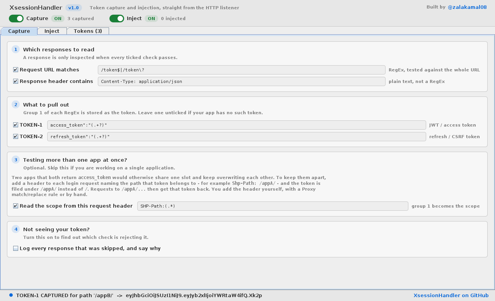
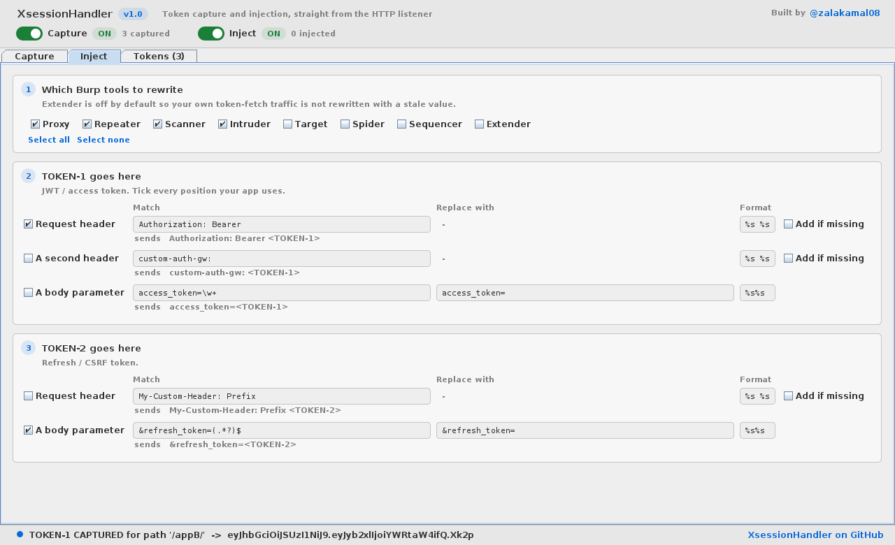
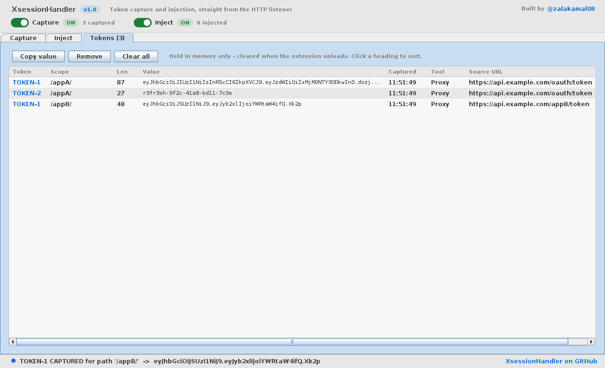
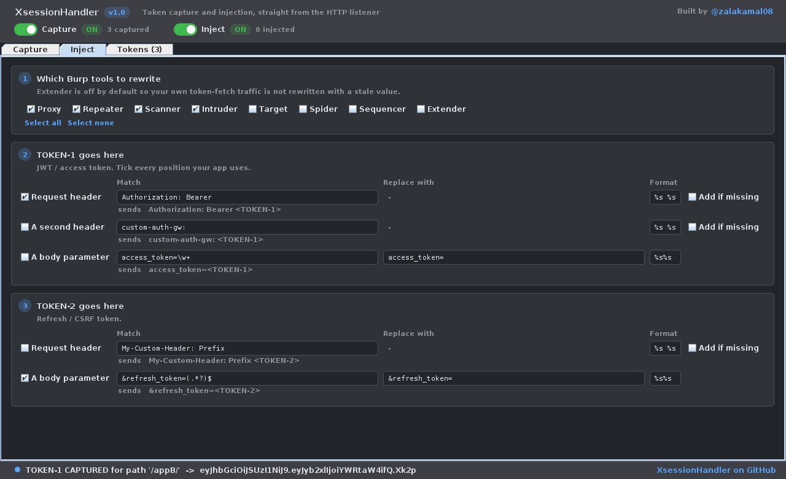

# XsessionHandler

> ### Shoutout to the original project
>
> This project stands on the shoulders of **[Session Handler Plus](https://github.com/PortSwigger/session-handler-plus)** by **[Vinaya Kumar (@V9Y1nf0S3C)](https://github.com/V9Y1nf0S3C/Session-Handler-Plus)**, published in the [PortSwigger BApp Store](https://portswigger.net/bappstore).
>
> Every idea here - reading tokens straight out of responses, the `Shp-Path:` header for juggling several applications, the token/format/prefix model for rewriting headers and bodies - comes from that extension. All credit for the design goes to the original author.
>
> **What this fork changes:** the Jython extension was rewritten in Java, and the setup was simplified - tokens are captured and injected automatically by the HTTP listener instead of requiring session handling rules, macros and Burp Cookie Jar entries.

The Session Handler Plus (SH+) Burp Suite extension gives you working session handling for JWTs, access tokens, refresh tokens and CSRF tokens **without configuring a single session handling rule, macro or cookie jar entry**.

It does two things, both from Burp's HTTP listener:

1. **Capture** - watches responses, pulls TOKEN-1 / TOKEN-2 out of the body with a RegEx and holds them in memory.
2. **Auto-replace** - rewrites every outgoing request with the freshest token *before the request is sent*.

Turn the extension on, log in once, and the rest of your traffic carries a valid token.

**Main features:**

1. Reads tokens from responses and keeps them in memory - no extra request needed to fetch a valid token, and no Burp Cookie Jar to inspect or clean up.
2. Injects tokens into request headers and/or the request body, with a customisable format (prefix, suffix, separator) set from the GUI.
3. Rewrites requests directly from the HTTP listener, with a per-tool switch for Proxy, Repeater, Scanner, Intruder, Target, Spider, Sequencer and Extender.
4. Validates the request/response before reading tokens, so unrelated responses are skipped.
5. Handles several applications at once: send a `Shp-Path:` request header and each application's tokens are stored and matched by path.
6. Shows every captured token live in the SH+ tab - path, length, full value, capture time, source URL - with copy / remove / clear.

## Quick start

1. Load the extension (see *Build & Installation* below). Both switches are on by default.
2. Open the **SH+** tab, go to **Capture**, and set **TOKEN-1** to a RegEx matching the token in your login response - the default is `access_token":"(.+?)"`, and group 1 is what gets stored.
3. Set **Request URL matches** to a RegEx for your login/token endpoint. The default is `/token$|/token\?`.
4. Switch to **Inject** and set **Request header** to the header your app uses. The default is `Authorization: Bearer`.
5. Log in through Burp once. The token shows up in the **Tokens** tab and every following request is rewritten with it.

Every field applies the moment you type it - there are no "Set" buttons. An invalid RegEx turns the field red and is simply not applied, so half-typed input never breaks your traffic.

## The three tabs

A header strip sits above the tabs at all times: the two master switches (**Capture** and **Inject**) with their ON/OFF state and live counters, so you can always see and toggle what the extension is doing without leaving the tab you are on.

### Capture - where tokens come from

<kbd></kbd>

| Setting | What it does |
| --- | --- |
| Request URL matches | RegEx against the full URL; non-matching responses are ignored |
| Response header contains | Plain substring, not a RegEx |
| TOKEN-1 | RegEx read from the response body - group 1 is the token (Ex: JWT / access_token) |
| TOKEN-2 | RegEx read from the response body - group 1 is the token (Ex: refresh_token / csrf_token) |
| Read the scope from this request header | See *Testing more than one app at once* below |
| Log every response that was skipped | Prints which check rejected a response - turn it on while tuning your RegEx |

Every capture is printed to the extension output with the **new value in full**, plus the previous value when a token is rotated:

```
[2026-01-01 10:15:42] <- TOKEN-1 UPDATED [Proxy] [path:/] [len:812] [URL:/oauth/token]
         new value: eyJhbGciOiJIUzI1NiIsInR5cCI6IkpXVCJ9...
         old value: eyJhbGciOiJIUzI1NiIsInR5cCI6IkpXVCJ9...
```

### Inject - where tokens go

<kbd></kbd>

**Which Burp tools to rewrite** picks the scope. Proxy, Repeater, Scanner and Intruder are on by default; Extender is off so your own token-fetch traffic is not rewritten with a stale value.

TOKEN-1 has three positions (two headers and a body parameter), TOKEN-2 has two. Each row is:

| Column | Meaning |
| --- | --- |
| Match | For a header: the prefix to look for (`Authorization: Bearer`). For the body: a RegEx (`access_token=\w+`) |
| Replace with | Body rows only - the literal text put back in front of the token (`access_token=`) |
| Format | How name and token are joined. `%s %s` gives `Authorization: Bearer eyJ...`; `%s%s` gives no space |
| Add if missing | Header rows only - add the header when the request does not already carry it |

Hover a row's fields to see a live **sends** preview of exactly what the request will carry, using a real captured token when there is one.

### Tokens - what has been captured

<kbd></kbd>

Token, scope, length, full value, capture time, capturing tool and source URL. Sort by any column, **Copy value** puts one on the clipboard, **Remove** drops a single entry, **Clear all** empties the store. Tokens live only as long as the extension is loaded.

### Both themes

Colours and fonts are taken from Burp's own look and feel, so the tab fits the dark theme as well as the light one:

<kbd></kbd>

*(Screenshots rendered from the extension's own UI code; Burp applies its own fonts and widget styling on top.)*

## Working with several applications

Add a `Shp-Path:` header to your login requests and each application's tokens are kept separately:

```
Get admin tokens for      ->  Shp-Path: /Module1/Admin/
Get HR tokens for         ->  Shp-Path: /Module2/HR/
Get employee tokens for   ->  Shp-Path: /Module3/Employee/
```

When a request goes out, SH+ picks the token whose stored path best matches the request URL: exact match first, then progressively shorter parent paths, then the `/` entry as a fallback.

## Build & Installation

This is a pure Java Burp extension - no Jython interpreter required.

**Use the pre-built jar**

1. Download `session-handler-plus.jar` from the [Releases](../../releases) page.
2. In Burp Suite go to *Extensions -> Installed -> Add*.
3. Set *Extension type* to **Java**, select the jar and click *Next*.

**Build from source**

Requires JDK 17+ and Maven:

```
mvn clean package
```

The extension jar is written to `target/session-handler-plus.jar`.

## Changelog

**v1.1** - UI density pass

- Tightened spacing across the Capture/Inject tabs so both fit with far less scrolling.
- The Inject tab's per-row "sends" preview is now a hover tooltip instead of a permanent extra row.
- Fixed the credit link's hover state, which could show raw HTML tags under some look-and-feels.
- Removed the old Jython-extension screenshots/videos from this README.

**v1.0** - first release of XsessionHandler

- Rewritten from the original Jython extension into pure Java (legacy Burp Extender API). No Jython interpreter required.
- Tokens are captured from responses and injected into outgoing requests **straight from the HTTP listener, before the request is sent**. No session handling rules, macros or Burp Cookie Jar entries.
- Tokens are held in memory and shown in a live table, with `Shp-Path:` scoping for testing several applications at once.
- Per-tool switch for injection: Proxy, Repeater, Scanner and Intruder on by default; Extender off so token-fetch traffic is not rewritten with a stale value.
- Interface split into **Capture / Inject / Tokens** tabs, with the master switches and live counters in a header strip visible from every tab.
- Colours and fonts derived from Burp's look and feel, so the tab fits both the light and the dark theme.
- Settings apply as you type; an invalid RegEx is flagged and simply not applied, so it can never break your traffic.
- Removed from the original: the cookie jar delete actions and the external script launcher.
